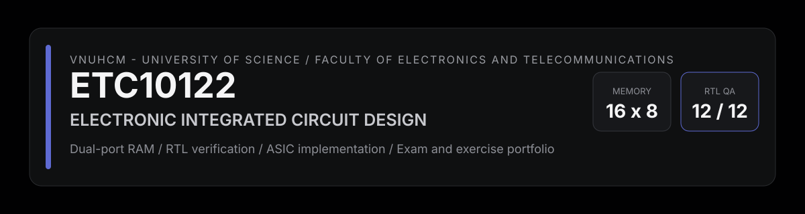
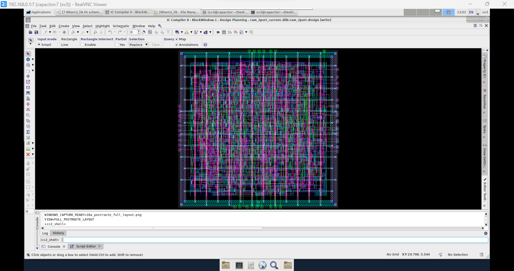

  

# ETC10122 — Electronic Integrated Circuit Design

An evidence-backed course portfolio covering dual-port memory design, RTL
verification, synthesis, formal equivalence, physical implementation, worked
exercises, and a fully developed solution to the 2020 examination.

**Student:** Lương Hải Long — 22207056
**Program:** Electronics and Telecommunications
**Institution:** University of Science, Vietnam National University Ho Chi Minh City

## Engineering focus

The principal design is a parameterized true dual-port synchronous RAM. The
released configuration stores 16 words of 8 bits, uses one shared rising-edge
clock, registers both read outputs, and applies `READ_FIRST` behavior. A
same-address simultaneous dual write is explicitly prohibited by the interface
contract and monitored by the testbench.

  

## Verified evidence

| Stage | Recorded result | Interpretation |
|---|---:|---|
| RTL simulation | 12/12 directed checks, 0 errors | Includes independent reads and cross-port `READ_FIRST` cases |
| Synthesis | 596 cells; 2,134.809647 cell-area units | Register-file implementation with no memory macro |
| Post-synthesis Formality | 160 passing, 0 failing | RTL and mapped implementation matched for the compared points |
| Post-route timing | +174.712677 ns setup; +0.053265 ns hold | Positive reported slack under the documented course setup |
| Post-PnR Formality | 160 passing, 0 failing | Logical equivalence maintained across the physical implementation boundary |

These figures describe one recorded laboratory run. They are not a foundry
signoff statement. The full ICV deck still reported 84 M1/VIA1 violations, and
extracted LVS was not available. See [Evidence boundaries](docs/EVIDENCE.md).

  
  
<em>Recorded ICC2 layout view used as implementation evidence; it is not a full-deck DRC or extracted-LVS certificate.</em>

## Repository map

| Path | Purpose |
|---|---|
| [`projects/dual-port-ram`](projects/dual-port-ram) | Current RTL, self-checking testbench, constraints, and portable Synopsys handoff scripts |
| [`coursework`](coursework) | Release index for the exercise set, worked 2020 exam, report, presentation, and speaker script |
| [`docs/COURSE_MAP.md`](docs/COURSE_MAP.md) | Mapping from the private course archive to the material that may be published |
| [`docs/REPRODUCIBILITY.md`](docs/REPRODUCIBILITY.md) | EDA Playground and campus-tool execution guide |
| [`docs/EVIDENCE.md`](docs/EVIDENCE.md) | Verified measurements, limitations, and claim boundaries |

## Design and verification flow

## Released coursework

Versioned releases contain the assessed documents without burdening Git
history with large binary revisions:

- 69-page dual-port RAM project report;
- 10-minute English presentation and speaker script;
- complete ETC10122 exercise portfolio;
- worked 2020 examination solution;
- source snapshots for reproducibility where redistribution is permitted.

Start with the [latest release](https://github.com/lhlizdabezt/ETC10122-Electronic-IC-Design/releases/latest).

## Citation and contact

Academic citation metadata is available in [`CITATION.cff`](CITATION.cff).
Project questions may be sent to
[22207056@student.hcmus.edu.vn](mailto:22207056@student.hcmus.edu.vn) or
[Luong Hai Long on LinkedIn](https://www.linkedin.com/in/lhlizdabezt).

## License

Student-authored source code is available under the [MIT License](LICENSE).
Course handouts, software, PDKs, and third-party materials are excluded; see
[`NOTICE.md`](NOTICE.md).
